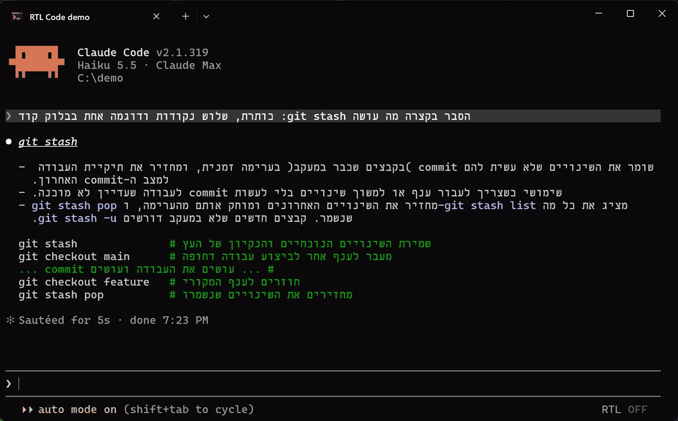
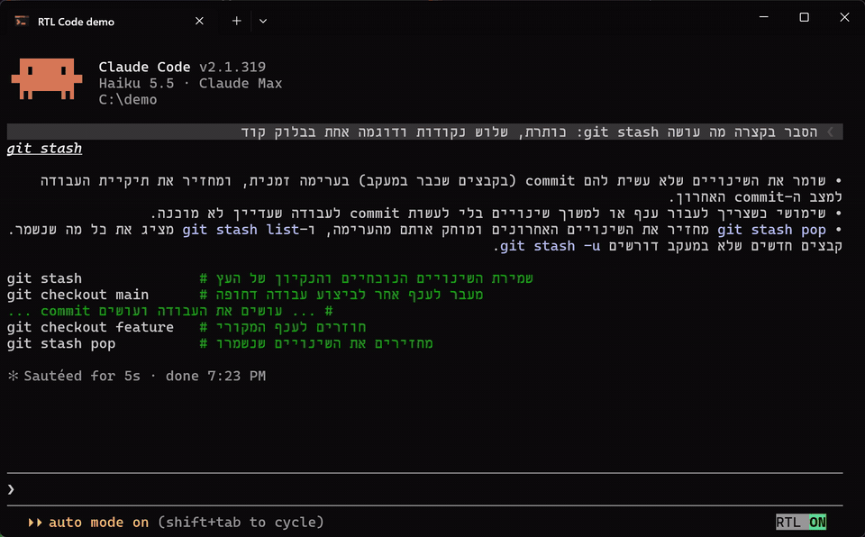
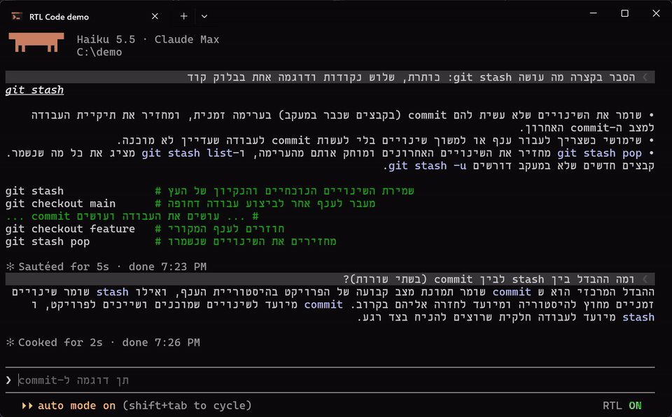

#  RTL Code

Make Hebrew in the Claude Code terminal read **right to left**.

A terminal lays every line out left to right, so a Hebrew answer from Claude
comes out with its sentences flush left, list bullets on the wrong side and
brackets facing the wrong way. Turn RTL Code on with `/rtl` (or the **RTL
OFF/ON** button under the prompt) and every Hebrew line is drawn flush right,
in reading order, with its markdown kept. English lines stay as they are.



## Install

At the prompt of a terminal session:

```
/plugin install rtl-code --marketplace roykersh/rtl-code
```

Answer `y` to add the marketplace and pick the user scope. Then run `/rtl on`
(or click **RTL OFF** in the footer under the prompt). That's all: there is
nothing to configure and nothing else to install.

From a shell instead: `claude plugin install rtl-code --marketplace roykersh/rtl-code`.
Sessions already open pick it up after a restart (`/exit`, then `claude -c`).

The mouse parts (the footer button, the preview's fold mark, the copy fix)
need Claude Code's fullscreen mode (`/config`, or `"tui": "fullscreen"` in
`~/.claude/settings.json`); `/rtl` works in either mode.

## What you get

- **Hebrew answers read right to left.** Every line that is mostly Hebrew is
  drawn flush right: paragraphs, headings, bullet and numbered lists (the
  marker on the right), checkboxes and quotes. Bold, italic and `code` keep
  their style, links show their text, and English words and commands inside
  a Hebrew line stay in their own order.
- **English stays English.** A line that is mostly English (counting letters
  outside quotes, code spans and links) stays left to right, and so do code
  blocks and tables, so `npm install`, paths and code never get flipped.
- **Brackets the right way round.** A bracket inside a right-to-left line is
  mirrored the way the Unicode bidi algorithm does it (rule L4), so
  `(בקבצים שכבר במעקב)` reads as written instead of `)בקבצים שכבר במעקב(`,
  while `foo(bar)` inside the same line is left alone.
- **A live preview of what you type.** While the prompt holds Hebrew, a
  mirrored copy of your draft shows right above the input box, flush right,
  with a thin blinking caret that follows the cursor as you type and move.
  The ▾ mark beside it folds it down to a single ▸ (and back); the choice is
  remembered.
- **Your own messages stand out.** A Hebrew message you sent keeps the prompt
  row's grey background, with the `❯` marker mirrored to `❮` on the right.
- **"Waiting to be read".** A message you type while Claude is still working
  sits on an amber row marked `◷ ממתין לקריאה` ("waiting to be read") until
  Claude actually reads it, mid-turn or at the next turn, and then turns into
  a normal message row.
- **Copy and paste that works.** Text selected off the terminal comes out of
  a right-to-left line in visual order, which pastes backwards. RTL Code puts
  the same selection back on the clipboard in reading order (words, brackets,
  and wrapped lines joined back to the sentence they came from).
- **Claude writes for it.** While RTL Code is on, Claude gets a short system
  prompt section on writing mixed Hebrew/English so it lays out cleanly:
  start each Hebrew line with a Hebrew word, put a space around English words
  instead of `ה-API`, put commands and paths in backticks, and quote Hebrew
  inside English answers. Toggling mid-session tells Claude with a one-line
  note.
- **Remembered.** On or off is saved across sessions.

### The draft preview



### Messages typed while Claude works



## Commands

| Command | What it does |
| --- | --- |
| `/rtl` | Toggle RTL Code on or off. |
| `/rtl on` / `/rtl off` | Turn it on or off. |
| **RTL OFF/ON** (footer) | The same toggle, as a button under the input box. |

## How it works

RTL Code is a hooks module (TypeScript) on Claude Code's plugin API. It
writes no escape sequences of its own: it hooks Claude Code's rendering of
the message rows (`ui.render` on `AssistantMessage` and `UserMessage`) and
hands each right-to-left line to the renderer as a `Text` with `dir="rtl"`,
which lays it out right to left and flush right. Lines with no Hebrew, or
mostly English, go to Claude Code's own markdown renderer untouched. No
control characters are inserted on the terminal: Windows Terminal draws bidi
marks as boxes.

The direction of a line is decided by the letters in it (Hebrew vs Latin),
not counting text in quotes, code spans and links, so `הרץ את npm install
עכשיו` is a Hebrew line and `Run "שלום" now` is an English one.

## Limits

- **Hebrew only.** Lines are detected by Hebrew letters. Arabic, Persian and
  other right-to-left scripts are not detected, so their lines are drawn as
  Claude Code draws them. (Adding them is mostly a matter of the letter
  ranges in `hooks/bidi.ts` and `hooks/blocks.ts`: pull requests welcome.)
- **Terminal first.** Tested in Windows Terminal on Windows 11 with Claude
  Code 2.1.318 and 2.1.319. In the Claude desktop app the toggle is a pill
  above the prompt and lines get Unicode bidi marks instead (the app runs the
  bidi algorithm itself); the preview, the waiting row and the copy fix are
  terminal-only.
- **Fullscreen for the mouse.** The footer button and the fold mark take a
  click only in fullscreen mode, and the copy fix reads Claude Code's own
  selection, which exists only there. In the classic (scrolling) mode, use
  `/rtl`; text you select there is selected by the terminal itself.
- **The copy fix is a re-copy.** Claude Code copies the selection when the
  mouse lets go; about 0.3 s later RTL Code puts the fixed text on the
  clipboard (and again a moment after). Paste right after letting go and you
  may get the reversed text. A line's direction is guessed from its letters
  (Hebrew final letters at the start of a word mean it is reversed), so a
  very short selection can be guessed wrong.
- **Tables stay left to right**, cell order and all; a Hebrew cell is drawn
  by Claude Code's own table renderer.
- **The writing rules apply from the next session.** A session's system
  prompt is fixed once it starts, so turning RTL Code on mid-session sends
  the rules to Claude as a note instead.
- Claude Code's plugin API is early access: it can change between releases.
  Every hook fails soft: if one breaks, Claude Code draws the row as usual.

## What it touches

- **Display**: the transcript's message rows, the band above the prompt (the
  draft preview) and the footer under it (the button), through Claude Code's
  `ui.render` hooks. Only what is drawn changes: nothing stored in the
  transcript or sent to the model is rewritten.
- **The model's context**: while on, one extra system prompt section (the
  writing rules above). Turning it on or off mid-session appends one short
  note to the conversation, which Claude reads.
- **Clipboard**: in the terminal, while on, it checks Claude Code's own
  selection every 300 ms; when a selection holding right-to-left lines has
  stopped changing, it writes the same text in reading order to the
  clipboard. It never reads the clipboard, and nothing else is copied.
- **Files written**: the plugin's own store (a JSON file in your Claude Code
  config folder) with two values: on/off, and whether the preview is folded.
- **Hooks**: session start, `/rtl`, prompt compose (the system prompt
  section), prompt submit / edit / change (to mirror the draft and to spot a
  message typed mid-turn), session append, turn start and turn complete (to
  see when Claude reads a waiting message; it observes and never changes a
  row), copy, and the renders above.
- **Processes, network, settings**: none. No Claude Code setting is changed.

## Updating and uninstalling

`claude plugin update rtl-code@rtl-code` (or `/plugin`), then restart the
session. To remove it: `/plugin uninstall rtl-code@rtl-code`, or
`claude plugin uninstall rtl-code@rtl-code` from a shell.

## Developing

Load the plugin from your clone with `claude --plugin-dir <clone>`: Claude Code
then writes the plugin API's TypeScript declarations to
`.claude-plugin/types/` (gitignored), which `tsconfig.json` points at, so
`tsc -p .` type-checks `hooks/` and `tests/`. `claude plugin test .` runs the
tests in `tests/`, and `claude plugin validate .` checks the manifests and
the hooks module.

## License

MIT
